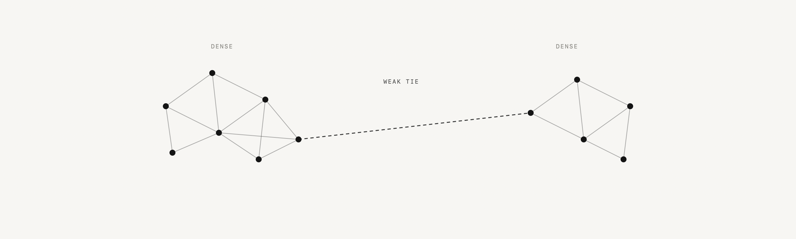
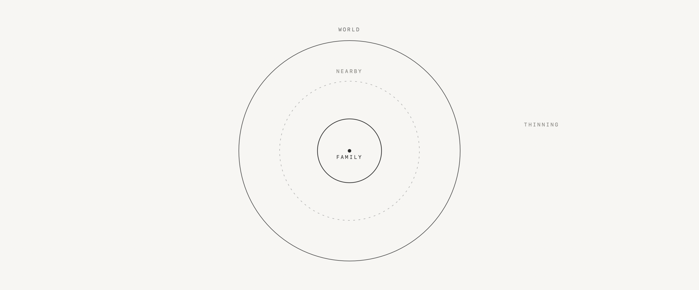

### Lumen

Small tools for macOS, and notes on the side.

  <picture>
    <source media="(prefers-color-scheme: dark)" srcset="assets/fig-weak-ties-dark.png">
    
  </picture>

» Work — [Fluxa](https://github.com/Young-Gl/Fluxa-Mac) · [Backup Control](https://github.com/Young-Gl/backup-control)

» Notes — [弱连接 · Weak Ties](essays/2026-11-10-weak-ties.md) · [附近 · The Neighbourhood](essays/2026-11-10-neighbourhood.md) · [前台 · Front Stage](essays/2026-11-10-front-stage.md)

  <picture>
    <source media="(prefers-color-scheme: dark)" srcset="assets/fig-nearby-dark.png">
    
  </picture>

  <picture>
    <source media="(prefers-color-scheme: dark)" srcset="assets/fig-front-dark.png">
    
  </picture>

» Reading — Illich, *Tools for Conviviality*; Scott, *Seeing Like a State*; Weiser, *The Computer for the 21st Century*; Star, *The Ethnography of Infrastructure*

**Marginalia**

> If men define situations as real, they are real in their consequences.
> W. I. Thomas &amp; D. S. Thomas, <i>The Child in America</i> (1928)

> Taste classifies, and it classifies the classifier.
> Pierre Bourdieu, <i>Distinction</i> (1979)

> Man is an animal suspended in webs of significance he himself has spun.
> Clifford Geertz, <i>The Interpretation of Cultures</i> (1973)

[Contact](https://github.com/Young-Gl/Young-Gl/issues) | [github.com/Young-Gl](https://github.com/Young-Gl)
