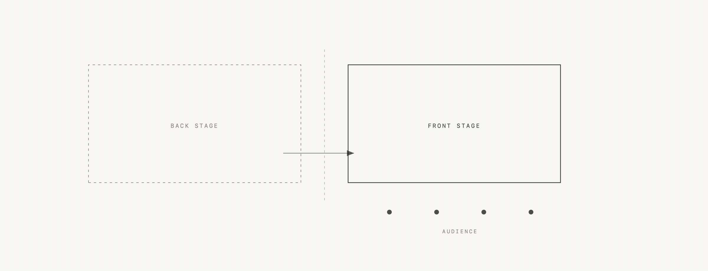

  <picture>
    <source media="(prefers-color-scheme: dark)" srcset="../assets/fig-front-dark.png">
    
  </picture>

Goffman 把日常生活分成前台和后台:前台是表演给观众看的部分,后台是准备、出错和卸妆的地方。

他写《日常生活中的自我呈现》是 1959 年,观察对象是餐厅服务员和医生。今天最彻底的前台大概是社交媒体——不是因为它更假,而是因为后台越来越难找。

发一条动态,要挑照片、改文案、想分组可见。这本来是后台的活,却被搬到了前台完成,而且是在所有观众都在场的情况下完成。

我删过一次朋友圈,删完发现没什么变化。观众比我想的少得多。

> All the world is not, of course, a stage, but the crucial ways in which it isn't are not easy to specify.
> Erving Goffman, <i>The Presentation of Self in Everyday Life</i> (1959)

---

**Front Stage**

Goffman split daily life into front stage and back stage: the part performed for an audience, and the place where you prepare, make mistakes, and take the make-up off.

He was writing in 1959, watching waiters and doctors. Today the most thorough front stage is probably social media — not because it is more fake, but because the back stage is harder to find.

Posting something means choosing photos, editing the caption, deciding who can see it. That is back-stage work, moved out front, performed with the audience already seated.

I once deleted a post and nothing changed. The audience was much smaller than I had assumed.
